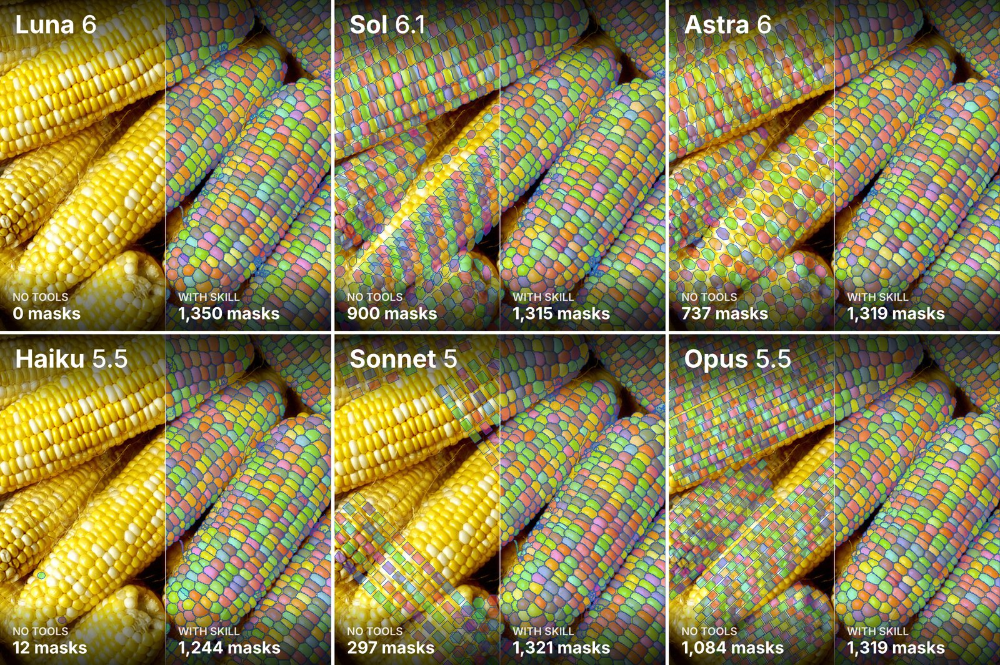
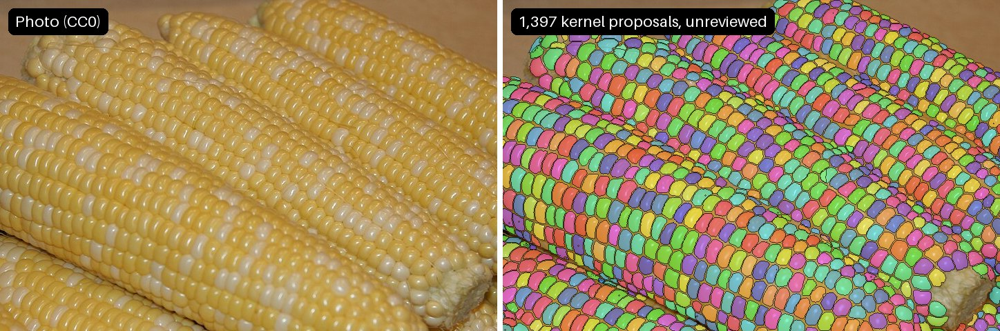

# sam3-segmentation

[](https://github.com/lillyguisnet/sam3-segmentation/actions/workflows/test.yml)
[](https://skills.sh/lillyguisnet/sam3-segmentation)

> This was mostly written by Opus 5.5 and not thoroughly checked by a human. It works on my machine, but haven't tested it elsewhere.

**An agent skill that outlines objects in photos with Meta's SAM 3, run on your
own NVIDIA GPU, and keeps everything it produces checkable.**



*Same six agents on the same corn photo, without tools (left half) and with this
skill (right half). Counts are each run's full set; nobody has checked these
outlines ([details](#does-it-work), [data](docs/six-models/record.json)). Photo:
ImageNet validation image ILSVRC2012_val_00000408; copyright belongs to its
original photographer and it is not covered by this repository's licence. It
will be removed on request.*

Ask your coding agent (Claude Code, Codex, Cursor, Pi, OpenCode and about 75
others) to "outline every kernel", "cut out the dog" or "count the seeds", and
this skill gives it the model, the commands and the rules to do it properly:

- **Quick calls:** every instance of a phrase ("all the jars"), more objects like
  an example box, one object from a click or a box, or "segment everything".
- **A careful workflow** for many small objects or parts (kernels, seeds, cells,
  insects): overlapping close-up crops, every raw candidate saved, score checks,
  review sheets and flags, recorded and reversible review decisions, boundary
  refinement, PNG and COCO RLE exports, and a zoomable viewer.
- **Honest output:** masks are reported as model proposals, never as verified
  ground truth, with what is uncertain listed.

## Install

Pick one. Each installs the same skill folder.

```sh
# Any agent (Claude Code, Codex, Cursor, OpenCode, Gemini CLI, ...). Needs Node.js 22+.
npx skills add lillyguisnet/sam3-segmentation        # add -g for every project

# Claude Code plugin, with updates (Claude Code 2.1.275 or later):
/plugin install sam3-segmentation --marketplace lillyguisnet/sam3-segmentation

# No Node.js: copy the folder yourself (--target claude, codex or pi)
git clone https://github.com/lillyguisnet/sam3-segmentation
python3 sam3-segmentation/install.py --target claude
```

Then ask your agent in plain words. The skill loads by itself when the request
fits; you can also name it (`/sam3-segmentation` in Claude Code, where a plugin
install shows it as `/sam3-segmentation:sam3-segmentation`, or `$sam3-segmentation`
in Codex). For example:

> Outline every visible kernel in corn.jpg, and the whole ears separately. Keep
> overlapping levels, check every region, and tell me what is uncertain. Ask me
> before any large download.

## What you need

| To... | You need |
|---|---|
| Run the model | Linux (or Windows WSL2) with an **NVIDIA GPU** (12-24 GB memory suggested), `uv`, about **11 GB** of disk, and your own accepted access to [facebook/sam3](https://huggingface.co/facebook/sam3) on Hugging Face |
| See a demo of the viewer and file formats, on generated shapes (no segmentation) | Any machine with [`uv`](https://docs.astral.sh/uv/getting-started/installation/); no GPU, model or account |

**Without an NVIDIA GPU, the skill cannot segment anything:** the model does not
run on CPU or Apple GPUs. The agent asks before
installing anything. It never asks for your Hugging Face token: you log in
yourself with `hf auth login`. The Python environments are created outside the
skill folder (in `~/.local/share/sam3-segmentation/`), so updates and several
installed copies reuse them.

## Demo without a GPU (no segmentation)

The model needs an NVIDIA GPU. Without one, you can only run a **demo**: it
draws generated shapes, runs the review and export tools on them, and opens the
viewer, so you can see what the results look like before installing anything
large. It does not segment your photos and does not use the model.

```sh
S=~/.claude/skills/sam3-segmentation     # wherever the skill was installed
sh "$S/scripts/run" base segment.py demo --out /tmp/sam3-demo
sh "$S/scripts/run" base python -m http.server 8000 --bind 127.0.0.1 --directory /tmp/sam3-demo/export
```

Open http://127.0.0.1:8000 to see the viewer on the generated shapes.

## Does it work?

**On corn, with six different agents.** Six models (GPT-6 Luna, GPT-6.1 Sol,
GPT-6 Astra, Claude Haiku 5.5, Sonnet 5 and Opus 5.5) each ran the full workflow
alone, with only the skill and a corn photo. Each finished with a full set of
kernel proposals:

| Agent | Time | Kernel proposals | Removed after review | First run's kernels also found |
|---|---:|---:|---:|---:|
| Luna | 8 min | 1,350 | 0 | 98.6% |
| Sol | 24 min | 1,315 | 45 | 97.2% |
| Astra | 30 min | 1,319 | 41 | 97.6% |
| Haiku | 40 min | 1,244 | 111 | 92.4% |
| Sonnet | 42 min | 1,321 | 37 | 97.2% |
| Opus | 40 min | 1,319 | 41 | 97.8% |

"First run's kernels also found" means at least half of the outline overlaps an
outline from the run the skill was built from (1,310 kernels). That run was also
made with SAM 3, so this measures agreement between agents, **not accuracy**: no
person has checked these outlines. Luna skipped the review; Haiku removed too
much, including real kernels. The same six models with no tools, asked to trace
the kernels by looking, returned between 0 and 1,084 shapes that did not follow
the kernels (the picture at the top).

**On a free photo you can reuse.** The same steps with no agent review, on a
[CC0 corn photo](https://commons.wikimedia.org/wiki/File:Corn_ready_for_removing_kernels_from_cob.jpg):
1,397 kernel and 11 ear proposals in about 3 minutes on one RTX 3090.
[Rebuild it yourself](docs/hero/make.sh).



**Beyond corn.** Trials on a dog, jars, insects, mushrooms and cattle produced
useful outlines, but also background mistakes and parts counted as whole
objects. [Report, with failures](docs/cross-domain-trials.md).

**Does the agent use it, and use it well?** Automated tests with Claude Haiku,
Sonnet and Opus 5.5: Sonnet and Opus picked the skill for all 10 kinds of
request it should handle and none of the 10 near-misses (customer segmentation,
CT scans, video, OCR...); Haiku sometimes counted by eye instead. With the skill,
agents told a Mac user the truth about GPU support, refused to use a pasted
token, and stated the 11 GB download before asking to install; without it they
mostly did not. [Evals and full results](evals/README.md).

## Limitations

- Outputs are proposals. To claim accuracy, compare against masks a person has
  checked, never against these drafts.
- The skill does not yet say when a review is finished, which reviewer to use,
  or stop an agent from removing many proposals unseen. See the
  [changelog](CHANGELOG.md).
- Small objects need the full workflow; a quick call on a whole photo can miss
  them entirely.
- Not for video, medical images, or classifying and editing pictures.

## Documentation

- [The agent's instructions](skills/sam3-segmentation/SKILL.md)
- [Quick SAM calls](skills/sam3-segmentation/references/direct-sam.md)
- [Setup and troubleshooting](skills/sam3-segmentation/references/setup.md)
- [Method and coordinates](skills/sam3-segmentation/references/method.md)
- [Configuration, budgets and run files](skills/sam3-segmentation/references/configuration.md)
- [Review protocol](skills/sam3-segmentation/references/review.md)
- [Lessons from earlier mistakes](skills/sam3-segmentation/references/lessons.md)
- [Testing and reproducibility](TESTING.md) · [Evals](evals/README.md) · [Changelog](CHANGELOG.md)

## Development

```sh
uv sync --locked --project skills/sam3-segmentation --group dev
uv run --locked --project skills/sam3-segmentation --group dev pytest tests
uv run --locked --project skills/sam3-segmentation --group dev ruff check skills/sam3-segmentation/scripts tests install.py
claude plugin validate --strict .
```

The tests need no GPU, model, account or network inference. Keep the skill
folder self-contained: it must work when copied anywhere on its own.

## Licence and privacy

[MIT](LICENSE) for this repository. SAM 3's code and weights are Meta's, under
their own terms, and are downloaded by you, not included here. Photo, annotation
and provider rights are separate questions. This project is not affiliated with
Meta. No private photos, masks, weights or credentials are in this repository;
the test photos are public domain or CC0 ([credits](evals/fixtures/CREDITS.md)).
